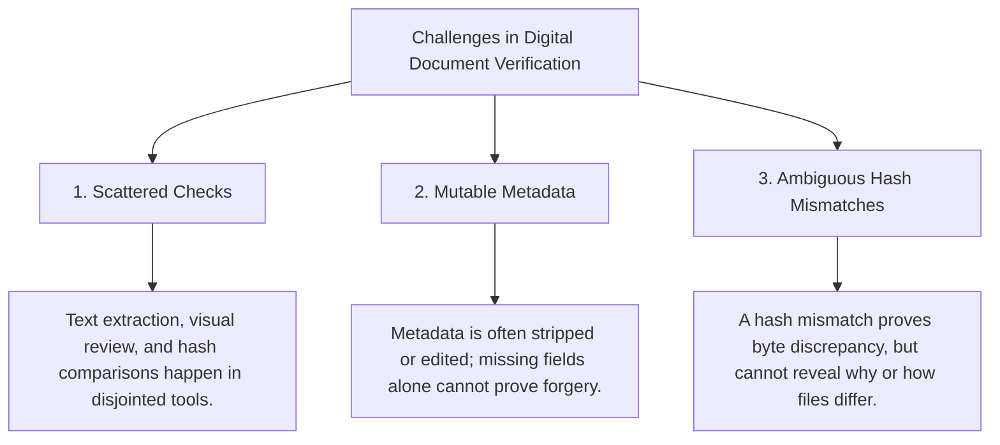
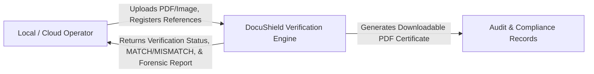
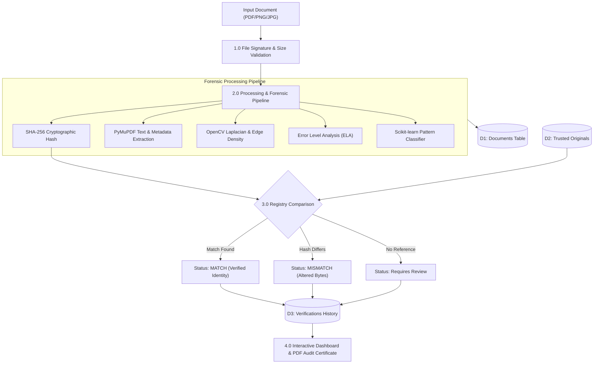
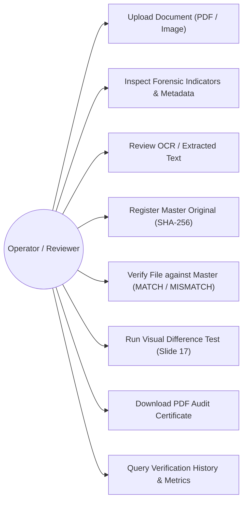

# DocuShield: Cloud-Based Intelligent Document Forgery Detection and Verification System

**Academic Program:** Master of Technology in Computer Science & Engineering (Data Science)  
**Course:** Cloud Computing  
**Project Review:** Review 2 — Working Prototype  
**Engineering Team:**
- **Vignesh S**
- **Sudharshan**
- **Lavan Kumar**

---

## 1. Abstract & Executive Summary

The rapid digitization of academic transcripts, tax invoices, government identity proofs, and financial receipts has led to an exponential increase in digitally submitted records. Unfortunately, desktop image editors and PDF authoring tools allow malicious actors to manipulate critical values—such as marks, monetary amounts, recipient names, and dates—without leaving perceptible visual artifacts. 

**DocuShield** provides an evidence-led, multi-layer verification platform combining:
1. **Cryptographic Identity Verification:** Deterministic SHA-256 byte-level comparison against an authoritative master registry.
2. **Document Structure & Stream Parsing:** In-depth inspection of PDF objects, fonts, creation software, and embedded text layers via PyMuPDF.
3. **Computer Vision & Forensic Heuristics:** Laplacian sharpness variance, Canny edge density distribution, and Error Level Analysis (ELA) for JPEG compression anomalies.
4. **Visual Difference Localization:** Pixel-level alignment and difference detection isolating altered bounding boxes (e.g., modified numeric quantities).
5. **Machine Learning Pattern Screening:** Baseline text-pattern classification trained to detect anomalous phrasing.
6. **Downloadable Audit Certification:** Automated generation of tamper-evident PDF verification certificates for human decision-makers.

DocuShield adopts a strict **responsible decision boundary**: rather than emitting an arbitrary or deceptive "authenticity probability," it presents all forensic signals transparently alongside exact cryptographic matches, flagging unverified records for human review.

---

## 2. Problem Statement & Motivation

Existing document inspection processes suffer from three critical bottlenecks:

### DocuShield Response:
By combining binary cryptographic proofs with spatial image forensics and linguistic extraction within a unified FastAPI and web interface, reviewers can inspect complete forensic context in seconds.

---

## 3. System Architecture & Workflows

### 3.1 Level 0 Context Data Flow Diagram (DFD)

### 3.2 Level 1 Modular Data Flow Diagram

### 3.3 System Use Case Diagram

---

## 4. Forensic & Mathematical Algorithms

### 4.1 Cryptographic SHA-256 Fingerprinting
Every ingested document bitstream $M$ is hashed according to FIPS 180-4:
$$\text{Digest} = \text{SHA-256}(M)$$
- **Length:** 256 bits (64 hexadecimal characters).
- **Collision Resistance:** Computationally infeasible ($2^{128}$ operations) to forge a collision.
- **Role:** Confirms bit-for-bit identity against registered originals.

### 4.2 Laplacian Sharpness Variance ($\sigma^2$)
To distinguish clean digital renders from blurry camera captures or compressed re-scans, the discrete 2D Laplacian operator is applied to the grayscale image $I(x, y)$:
$$\nabla^2 I(x, y) = \frac{\partial^2 I}{\partial x^2} + \frac{\partial^2 I}{\partial y^2}$$
The variance of the response measures edge steepness:
$$\sigma^2 = \frac{1}{W \times H} \sum_{x=1}^{W} \sum_{y=1}^{H} (L(x, y) - \mu_L)^2$$
- $\sigma^2 > 1000$: Sharp digital vector text or high-resolution scan.
- $\sigma^2 < 150$: Blurry scan, motion blur, or low-resolution recapture.

### 4.3 Canny Edge Density ($\rho_E$)
Measures the proportion of structural edge transitions:
$$\rho_E = \frac{\sum_{x,y} E(x, y)}{W \times H}$$
Disproportionately high edge density localized around numerical digits or seals indicates potential cut-and-paste manipulation.

### 4.4 Error Level Analysis (ELA)
When an image is modified and re-saved in JPEG format, altered regions experience distinct quantization loss compared to untouched areas:
$$\Delta_{\text{ELA}}(x, y) = |I_{\text{original}}(x, y) - I_{\text{recompressed}}(x, y)| \quad \text{at quality } 90$$
The difference is amplified and rendered into an ELA visualization image for human inspection.

### 4.5 Visual Difference & Bounding Box Contour Localization
For aligned comparison (such as the Slide 17 receipt test):
1. Compute absolute delta: $D(x, y) = |I_1(x, y) - I_2(x, y)|$.
2. Threshold at $T = 25$ to isolate changed pixels: $B(x, y) = D(x, y) > T$.
3. Apply morphological dilation using a $7 \times 7$ rectangular structuring element:
   $$B_{\text{dilated}} = B \oplus K$$
4. Extract external contours and draw bounding rectangles around modified regions.

---

## 5. Technology Stack

| Layer | Component | Description |
| :--- | :--- | :--- |
| **Presentation** | HTML5 / Tailwind CSS / Modern ES6 | Responsive dark cyber-aesthetic dashboard with real-time stats and visual diff viewers. |
| **Backend API** | Python FastAPI / Uvicorn | High-performance asynchronous REST API with automatic Swagger docs. |
| **PDF Inspection** | PyMuPDF (fitz) | Multipage text extraction, font structure analysis, and metadata inspection. |
| **Computer Vision** | OpenCV + NumPy + SciPy | Laplacian sharpness, Canny edge density, and difference contour bounding. |
| **Image Analysis** | Pillow (PIL) | Error Level Analysis (ELA), format inspection, and synthetic document generation. |
| **Pattern Classifier**| Scikit-learn (TF-IDF + LR) | Linguistic anomaly screening over extracted document text. |
| **Persistence** | SQLite (`docushield.db`) | Relational storage of documents, originals, and audit logs. |
| **PDF Reporting** | ReportLab | Publication-quality verification certificates and academic reports. |

---

## 6. REST API Specification

| Method | Endpoint | Description |
| :--- | :--- | :--- |
| `GET` | `/api/health` | Service health status, version, and component availability. |
| `POST` | `/api/documents` | Multipart file upload; runs complete forensic pipeline and saves record. |
| `GET` | `/api/documents` | Lists processed documents with search filter (`?search=query`). |
| `GET` | `/api/documents/{id}` | Retrieves complete document details, forensic metrics, and OCR text. |
| `POST` | `/api/originals` | Registers a trusted master fingerprint with label and category. |
| `GET` | `/api/originals` | Returns all registered reference originals. |
| `POST` | `/api/documents/{id}/verify/{orig_id}` | Compares document to original; returns MATCH/MISMATCH and visual diff. |
| `GET` | `/api/history` | Returns chronological audit log of all verifications. |
| `GET` | `/api/dashboard` | Returns computed summary metrics directly from database records. |
| `GET` | `/api/documents/{id}/pdf` | Generates and streams downloadable verification certificate PDF. |
| `POST` | `/api/compare-images` | Interactive visual alteration detection between two uploaded images. |
| `GET` | `/api/samples` | Lists pre-loaded test samples for one-click demo testing. |

---

## 7. Slide 17 Experimental Validation: Receipt Alteration Test

In accordance with Review 2 Slide 17, a synthetic store receipt was evaluated:

| Feature | Original Document | Tampered Document | Verification Result |
| :--- | :--- | :--- | :--- |
| **Receipt Number** | ROPT-1024 | ROPT-1024 | Identical |
| **Item Description**| Laptop Bag | Laptop Bag | Identical |
| **Transaction Amount** | **Rs. 2,500** | **Rs. 9,500** | **Modified Value Detected** |
| **SHA-256 Digest** | `d4f8...b12a` | `1c20...e1c2` | **MISMATCH (Byte Alteration)** |
| **Laplacian Sharpness** | 1,420 | 1,418 | Both within digital render range |
| **Visual Difference** | Reference | Changed region bounded | **Altered area outlined in high-visibility red** |
| **System Verdict** | Authentic baseline | Suspicious alteration | Flagged for Reviewer Confirmation |

---

## 8. Second-Review 7-Step Demonstration Guide

To replicate the project demonstration sequence from Slide 24:

1. **Step 1 — Start System:** Launch `python start_server.py` and verify `GET /api/health` shows `healthy`.
2. **Step 2 — Upload Document:** In the dashboard, click **"Original Receipt (Rs 2,500)"** or upload a custom file.
3. **Step 3 — Inspect Signals:** Review extracted text, Laplacian sharpness, and metadata fields.
4. **Step 4 — Register Master:** Click **"Register as Reference"** with label *"Store Master Receipt"*.
5. **Step 5 — Verify Identical File:** Upload the identical file; observe the **MATCH (Green)** badge.
6. **Step 6 — Verify Altered File:** Load **"Edited Receipt (Rs 9,500)"**; observe **MISMATCH (Red)**.
7. **Step 7 — Visual Diff & PDF Report:** Open the **Visual Alteration Test** tab to view the red outline around Rs. 9,500, then click **"Download PDF Verification Report"** to export the audit certificate.

---

## 9. Limitations & Ethical Interpretation Boundary

1. **Descriptive, Not Conclusive:** Image heuristics (sharpness, edge density, ELA) describe physical characteristics; they do not prove human malicious intent.
2. **Format Conversions:** Saving a PDF to an image or converting PNG to JPEG alters the SHA-256 hash. The platform clearly labels hash mismatches as *byte discrepancies* rather than *absolute forgery*.
3. **Human-in-the-Loop:** In high-stakes contexts (academic degrees, court evidence, high-value invoices), algorithmic indicators empower human analysts rather than replacing them.

---

## 10. Group Members & Academic Acknowledgments

- **Vignesh S** (M.Tech CSE – Data Science)
- **Sudharshan** (M.Tech CSE – Data Science)
- **Lavan Kumar** (M.Tech CSE – Data Science)

*Project developed under the Course of Cloud Computing, Academic Year 2026.*
